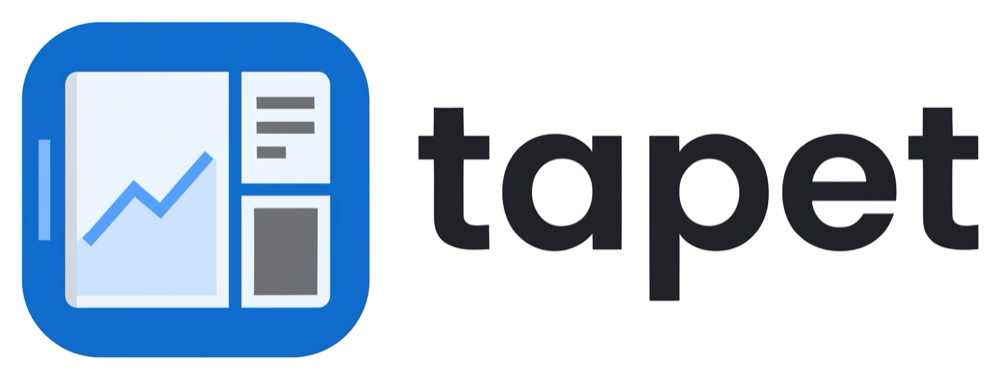
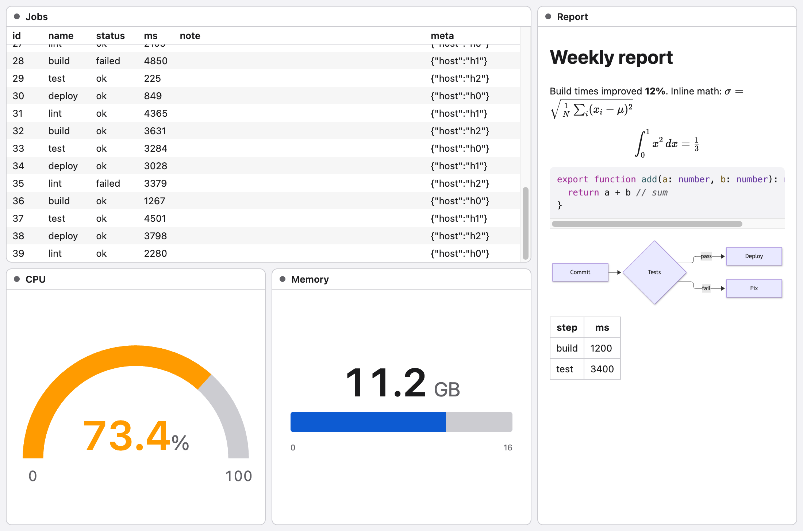

<h1></h1>

tapet is a display that AI agents direct over MCP to show things to their user.

<picture>
  <source media="(prefers-color-scheme: dark)" srcset="assets/views-dark.png" />
  
</picture>

## What it's for

Coding agents work with a lot of data their users want to see: test runs, logs, query results, reports, metrics. Usually the agent reads that data into its context and retells it in the chat. That costs tokens, and it can't show anything that keeps changing.

With tapet, the agent opens a window and lays out panels over MCP. Then it pipes command output from its own shell straight into those panels. The data never passes through the model, so a log that never ends or a result with a million rows costs the agent nothing. The user watches it live.

What people use it for:

- **Live logs:** `tail -f`, test runners and dev servers, with terminal colors and search. An optional LLM (the _smart trait_) keeps a rolling summary, e.g. "which tests fail and why".
- **Tables:** `jq` or CSV output that the user can sort, updated in place as rows change.
- **Documents:** reports in Markdown, with highlighted code, math and Mermaid diagrams. Also sanitized HTML, plain text and images.
- **Charts:** time series with zoom and a readout on hover, or any Vega-Lite spec.
- **Graphs:** dependency trees, call graphs and any edge list, up to a million nodes.
- **Maps:** GeoJSON features over a base map, e.g. results by town, colored by their numbers.
- **Anything else:** the agent's own code, e.g. with d3 or three.js from a package CDN, in a sandboxed frame.
- **Gauges:** the latest value of a metric, as a number, dial or bar.
- **Layout in plain CSS:** the agent arranges panels with CSS it already knows. It checks the result with a screenshot.

## How it works

```
agent ──MCP──▶ tapet mcp ──▶ tapet window (one per agent session)
agent's shell:   <command> | <pipe> ──────▶ a panel in that window
```

- **MCP carries control; shell pipes carry data.** `panel_create` returns a `pipe` command, and the agent runs `<command> | <pipe>` itself, with its harness's usual permissions.
- **Each panel declares its data:**
  - how the stream splits into items (`lines`, `ndjson`, `csv`, or the whole input as one document);
  - what each item does (append, replace, upsert or patch by key);
  - how long items are kept;
  - which view shows them.
- **One app, separate sessions:** one tapet app serves every agent, but each agent session gets its own window and background process. Sessions are kept fully apart.
- **Everything stays on your machine:** tapet listens on localhost only, with a token per session. Three things reach the network: smart panels send panel data to the model provider you configure, map panels load their base map from OpenFreeMap, and custom views can import packages from a few package CDNs. Nothing in the window can load from any other host.

### Views

| View       | Shows                                                  |
| ---------- | ------------------------------------------------------ |
| `log`      | lines, with terminal colors, search and follow         |
| `table`    | rows, with sorting and virtual scrolling               |
| `document` | Markdown (code, math, Mermaid), HTML, text or an image |
| `gauge`    | the latest value as a number, dial or bar              |
| `chart`    | time series (uPlot) and any Vega-Lite spec             |
| `graph`    | nodes and edges                                        |
| `map`      | GeoJSON features on a map                              |
| `custom`   | the agent's own code in a sandbox                      |

## Setup

tapet runs on macOS, Linux and Windows and needs Node 24 or later. It isn't on npm yet; until the first release, run it from a checkout of this repo, with [pnpm](https://pnpm.io):

```bash
pnpm install
```

```bash
pnpm build
```

Then add the MCP server to your agent. In Claude Code:

```bash
claude mcp add tapet -- node /absolute/path/to/tapet/packages/cli/src/main.ts mcp
```

Other harnesses take the same command in their MCP config:

```json
{
  "mcpServers": {
    "tapet": {
      "command": "node",
      "args": ["/absolute/path/to/tapet/packages/cli/src/main.ts", "mcp"]
    }
  }
}
```

That's all: the agent's first `window_update` starts the app. In a checkout, tapet uses the workspace's Electron. The published package will download its own with `tapet setup`.

### Smart panels (optional)

Smart panels need a model. Put the provider's key in your environment or in `~/.config/tapet/config.env`, e.g. `ANTHROPIC_API_KEY=…`. Then list the models smart panels may use in `~/.config/tapet/config.json`:

```json
{ "models": ["anthropic/claude-haiku-5-5"] }
```

tapet supports Anthropic, OpenAI (including OpenAI-compatible servers through `base_url`) and Google. A project can add its own `.tapet/config.json`. Keys can be referenced as `${NAME}` instead of written into the JSON, so a project's config is safe to commit. A daily token cap (2M by default) bounds the cost. See [the config docs](packages/cli/docs/config.md).

## Using it from an agent

You don't call tapet yourself; you ask your agent, which calls tapet's tools. tapet's own docs teach the agent the details: it calls `docs_get` for the topics it needs. Some examples:

**"Run the tests in watch mode and keep the failures on screen."**

```js
window_update({ name: 'tests', width: 900, height: 600 })
// → { session: "…" }: the agent records it, to reconnect after a restart

panel_create({
  id: 'tests',
  title: 'Tests',
  preset: 'log',
  retention: { last: 20000 },
  smart: {
    prompt: 'List the failing tests and why they fail. Update the previous list.',
    every: { items: 50 },
  },
})
// → { pipe: "node …/tapet/packages/cli/src/main.ts -c 127.0.0.1:53211/c/…" }
```

The agent runs the pipe in its shell, in the background, since watch mode never exits:

```bash
pnpm vitest --watch 2>&1 | <pipe>
```

**"Which endpoints are slowest?"**

```js
panel_create({
  id: 'slow',
  title: 'Slowest endpoints',
  preset: 'table',
  table: { columns: ['path', 'p99_ms', 'calls'] },
})
```

```bash
jq -c 'select(.p99_ms > 500)' stats.ndjson | <pipe>
```

The user sorts by clicking a column header. With `update: 'upsert'` and a `key`, rows update in place, e.g. one row per endpoint.

**"Graph the site's response time while I deploy."**

```js
panel_create({
  id: 'latency',
  title: 'Response time (s)',
  preset: 'timeseries',
  chart: { y: ['connect', 'total'] },
})
```

```bash
while true; do curl -s -o /dev/null -w '{"connect": %{time_connect}, "total": %{time_total}}\n' https://example.com; sleep 1; done | <pipe>
```

Without `chart.x`, each point is placed at the time it arrived. For anything beyond time series, `chart: { engine: 'vega-lite', spec }` takes a full Vega-Lite spec.

**"Show me which services call which."**

```js
panel_create({
  id: 'calls',
  title: 'Service calls',
  format: 'ndjson',
  update: 'append',
  view: 'graph',
})
```

```bash
jq -c '{source: .caller, target: .callee}' traces.ndjson | <pipe>
```

The nodes come from the edges. A force layout on the GPU handles a million of them; `graph: { layout: 'hierarchical' }` draws dependencies in layers instead.

**"Show the vote counts on a map."**

```js
panel_create({
  id: 'votes',
  title: 'Votes by town',
  preset: 'map',
  map: { color_by: 'votes', tooltip: ['name', 'votes'] },
})
```

```bash
jq -c '.features[] | .id = .properties.code' towns.geojson | <pipe>
```

Each feature replaces the one with the same `id`, so a count that changes repaints its town. The base map comes from OpenFreeMap, without country borders or names unless `map: { borders: true }`; `map: { base_map: false }` draws only the features.

**"Write up the incident and show it to me."**

```js
panel_create({ id: 'report', title: 'Incident report', preset: 'document' })
```

```bash
cat incident.md | <pipe>
```

Each pipe is one document. ` ```mermaid ` blocks become diagrams and `$…$` becomes math. `document: { content: 'image' }` shows a PNG or SVG instead, e.g. a plot the agent just made.

**"Keep an eye on the disk while the import runs."**

```js
panel_create({
  id: 'disk',
  title: 'Disk',
  preset: 'gauge',
  gauge: { style: 'dial', max: 100, unit: '%', thresholds: [{ at: 90, color: 'red' }] },
})
```

```bash
while true; do df / | awk 'NR==2 {print $5+0}'; sleep 10; done | <pipe>
```

**Layout.** The agent arranges panels with CSS and checks its work:

```js
window_update({ css: '#tapet { display: grid; grid-template-columns: 2fr 1fr }' })
panel_update({ id: 'report', css: 'h1 { color: var(--tapet-accent) }' })
window_screenshot()
```

### Tools

| Tool                                           | What it does                                                       |
| ---------------------------------------------- | ------------------------------------------------------------------ |
| `window_update`, `window_get`, `window_focus`  | open and arrange the window; read back its setup                   |
| `window_screenshot`, `window_inspect`          | see what the user sees: a PNG, or each panel's geometry            |
| `panel_create`, `panel_update`, `panel_remove` | panels and their settings; `panel_create` returns the pipe command |
| `channel_write`                                | send data the agent already has, e.g. a few numbers                |
| `smart_run`, `smart_read`, `models_get`        | run a panel's smart trait now, read its outputs, list the models   |
| `session_attach`, `session_end`                | reconnect after a harness restart; end the session                 |
| `docs_get`                                     | the docs, by topic                                                 |

## Development

```bash
pnpm test
```

Also `pnpm test:e2e` (builds the app, then drives it through MCP with Playwright), `pnpm lint`, `pnpm format` and `pnpm typecheck`. [DESIGN.md](DESIGN.md) holds the design and the decisions behind it, and `packages/cli/docs` holds the docs agents read.

## License

Apache-2.0
